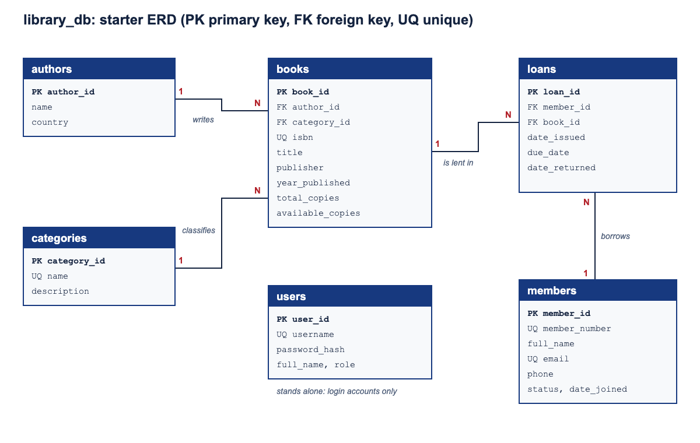

# Database design

Six tables. An author writes many books and a category holds many books. A member has many loans, and each loan
is one member borrowing one book. `users` are staff logins, not library members, so they stand alone.

A member can only have one open loan of the same book. `loans.open_loan_guard` is 1 while a loan is open and NULL
once it is returned, and there is a UNIQUE key on `(book_id, member_id, open_loan_guard)`. MariaDB allows many
NULLs in a unique key, so returned loans stay in the history and the book can be borrowed again later.

## Normal forms

- **1NF:** every table has a primary key and one value per column. A book's loans are rows in `loans`, not a list.
- **2NF:** every primary key is a single column, so nothing can depend on part of a key.
- **3NF:** no column depends on another non-key column. `books` stores `author_id`, not the author's name.
  `loans` stores `member_id`, not the member's phone.

## Tables

| Table | Keys | Why it is in 3NF |
|---|---|---|
| `authors` | PK `author_id`, UNIQUE (`name`, `country`) | Name and country describe the author only. |
| `categories` | PK `category_id`, UNIQUE `name` | Stored once, books point to it. |
| `books` | PK `book_id`, UNIQUE `isbn` (optional, NULL when a book has none), FK `author_id`, `category_id` | Only facts about the book. Author and category details stay in their tables. |
| `members` | PK `member_id`, UNIQUE `member_number`, `email` | Contact details and status describe the member only. |
| `loans` | PK `loan_id`, FK `member_id`, `book_id` | The dates describe one loan. Member and book details are not copied. |
| `users` | PK `user_id`, UNIQUE `username`, `email` | Login details only. A user has at most one emailed code waiting, so its `code_*` columns sit here. Only a hash of the code is kept. |

`books.available_copies` is a counter kept for speed. It should always equal `total_copies` minus the open loans.
Issuing and returning change the counter and the loan in one transaction, and `check-database.sh` checks that
the sample data agrees.

## Report queries

`database/queries.sql` has four: open loans by member, loans per category (the GROUP BY report), overdue loans
with days late and phone numbers, and every book with its author, category and copies out.
