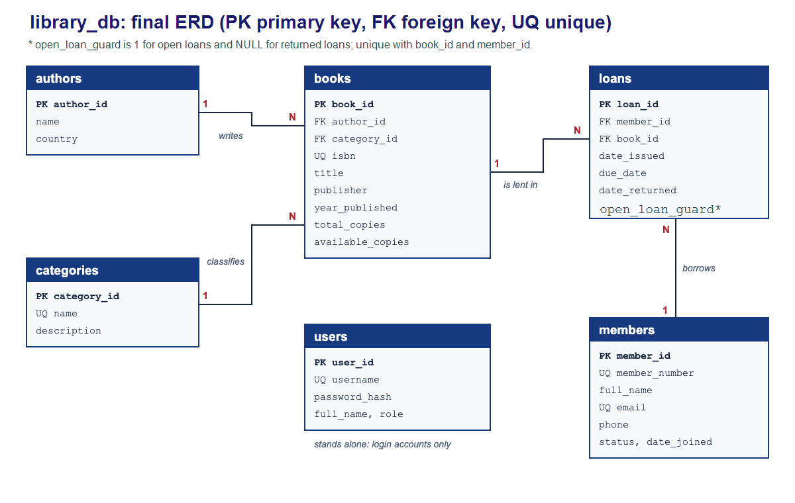

# Database design and normalization

## Final entity-relationship diagram

The schema contains six entities. An author writes many books, a category
classifies many books, and a member can have many loan records. Each loan
references one member and one book. User accounts are independent of member
records because they are staff login accounts, not library patrons.

The database also enforces a business rule on `loans`: a member may have only
one open loan for a particular book at a time. The generated
`open_loan_guard` column is `1` for an open loan and `NULL` for a returned loan.
The unique key on `(book_id, member_id, open_loan_guard)` rejects a second open
loan while allowing any number of returned loan-history records for the same
member and book.

## First, second, and third normal forms

- **1NF:** Each table has a primary key and stores one value per column; lists
  such as multiple authors or multiple loans are represented by related rows,
  not repeating columns.
- **2NF:** Every table uses a single-column primary key, so non-key attributes
  depend on the whole primary key. The composite unique key on
  `authors(name, country)` is an alternate candidate key; no non-key attribute
  depends on only part of it.
- **3NF:** Non-key attributes describe their table's key, not another
  non-key attribute. Descriptive author and category data live in their own
  tables rather than being repeated in `books`; member details are not copied
  into `loans`; and login details are isolated in `users`.

## Table-by-table justification

| Table | Keys and attributes | 3NF justification |
| --- | --- | --- |
| `authors` | `author_id` primary key; `name` and `country`; unique (`name`, `country`). | An author's name and country describe the author identified by `author_id`. The alternate unique key prevents duplicate author identities without storing author details in each book row. |
| `categories` | `category_id` primary key; unique `name`; optional `description`. | The category name and description depend on the category key. Category data are stored once and referenced from books. |
| `books` | `book_id` primary key; unique `isbn`; author and category foreign keys; title, publisher, publication year, total and available copies. | Book-specific attributes depend on the book key (with ISBN as an alternate key). Author and category descriptions are not stored here, avoiding transitive dependencies through their foreign keys. |
| `members` | `member_id` primary key; unique `member_number` and `email`; name, phone, status and join date. | Patron attributes depend on the member key. Loans reference the member rather than duplicating their personal details. |
| `loans` | `loan_id` primary key; member and book foreign keys; issue, due and return dates; generated open-loan guard. | Dates and the guard describe one loan. Member and book details remain in their parent tables. The guard is derived solely from `date_returned`, and its unique key enforces the one-open-loan rule while permitting multiple returned history rows. |
| `users` | `user_id` primary key; unique `username`; password hash, full name and role. | Login credentials and role depend on the user key. Staff login accounts are separate from patron records because they serve different purposes. |

`available_copies` is stored on `books` as an operational inventory counter so
issuing and returning can update it transactionally. It is expected to equal
`total_copies` minus the number of open loan rows; the database check script
verifies that invariant against the sample data. Application loan and return
operations must continue to update the counter and loan row together.

## Report queries

`database/queries.sql` contains four report queries: current loans by member,
loan totals by category, overdue loans with days overdue and phone number, and
every book with its author, category, and copies out. The category totals query
is the aggregate report; the other queries use joins to combine related data.
